# Documentación técnica

## Sistema automatizado de gestión de solicitudes de soporte técnico

| | |
|---|---|
| **Título del documento** | Documentación técnica del sistema |
| **Materia** | Programación en ambiente cliente servidor |
| **Proyecto** | Sistema automatizado de gestión de solicitudes de soporte técnico (segundo parcial) |
| **Autor** | Ailton Antonio Antonio |
| **Matrícula** | 2023330968 |
| **Grupo** | 703 |
| **Profesor** | Ing. Alex Ramírez Galindo |
| **Institución** | Tecnológico de Estudios Superiores de San Felipe del Progreso (TESSPP) |
| **Fecha** | 17 de noviembre de 2026 |
| **Versión del documento** | 1.0 |
| **Versión del sistema** | 1.0.0 |

---

## Control de versiones

| Versión | Fecha | Autor | Cambios |
|---|---|---|---|
| 1.0 | Noviembre de 2026 | Ailton Antonio | Versión inicial del documento técnico. |

---

## Contenido

1. [Introducción](#1-introducción)
2. [Objetivos](#2-objetivos)
3. [Desarrollo](#3-desarrollo)
4. [Conclusiones](#4-conclusiones)

---

## 1. Introducción

El presente documento describe el diseño, la implementación y la operación del **Sistema automatizado de gestión de solicitudes de soporte técnico**, desarrollado para la materia *Programación en ambiente cliente servidor* como proyecto del segundo parcial.

El sistema atiende un problema cotidiano en una institución educativa: las solicitudes de soporte técnico (equipos que no encienden, fallas de software, problemas de red, accesos y contraseñas, impresoras, etc.) suelen recibirse por mensajes informales, correo o de viva voz, sin un registro único, sin folio de seguimiento y sin visibilidad del estado de atención. La solución propuesta automatiza el ciclo completo de captura, registro, notificación y seguimiento:

1. El usuario llena un **Google Forms**.
2. Las respuestas se guardan automáticamente en una **hoja de Google Sheets**.
3. **n8n** detecta la fila nueva, normaliza los datos y llama a la **API REST**.
4. La API valida la información, la guarda en **PostgreSQL (Neon)** y devuelve un **folio** generado por la base de datos.
5. n8n envía un correo de confirmación al solicitante con su folio y actualiza la hoja.
6. Un **dashboard** construido en otra pestaña de la misma hoja muestra los indicadores de gestión.

La API está implementada en **Python 3.12.6 + Flask 3.1.0**, se sirve con **Gunicorn 23.0.0** en **Render** (plan Free) y persiste en **PostgreSQL en Neon** (plan Free; versión 15 o superior, el proyecto usa la versión por defecto 17). La automatización se implementa con **n8n autoalojado (Docker, v2.43.5)**. El documento está organizado para que cualquier integrante del equipo —o el profesor— pueda entender la arquitectura, reproducir el despliegue, consumir la API y validar el funcionamiento.

> **Documentos complementarios:** `README.md` (descripción general y ejecución local), `docs/guia-despliegue-render-neon.md` (paso a paso de despliegue), `docs/guia-google-forms-sheets.md` (formulario, hoja y dashboard) y `docs/pruebas-api.md` (evidencias de pruebas con curl y PowerShell).

---

## 2. Objetivos

### 2.1 Objetivo general

Diseñar, implementar y desplegar en la nube un sistema automatizado de gestión de solicitudes de soporte técnico que, a partir de un formulario de Google, registre cada solicitud en una base de datos PostgreSQL mediante una API REST propia, le asigne un folio único de seguimiento y notifique automáticamente al solicitante, manteniendo un dashboard actualizado para la gestión del área de soporte.

### 2.2 Objetivos específicos

1. **Diseñar el modelo de datos** de las solicitudes de soporte con restricciones de integridad (dominios válidos para categoría, prioridad y estado; validación de correo y de longitudes mínimas) en PostgreSQL.
2. **Implementar una API REST en Flask** con endpoints para crear, consultar, filtrar, actualizar el estado y calcular estadísticas de las solicitudes, aplicando validación y normalización de datos de entrada.
3. **Generar el folio de seguimiento de forma automática y segura** mediante una secuencia y un trigger `BEFORE INSERT` en la base de datos, con formato `SOL-AAAA-NNNN` y protección ante concurrencia.
4. **Proteger las operaciones de escritura** con una API key enviada en el header `X-API-Key`, comparada en tiempo constante, y con validación estricta del cuerpo JSON.
5. **Automatizar el flujo de punta a punta con n8n**: detección de la respuesta del formulario, normalización, llamada a la API, manejo de éxito/error, envío de correos con Gmail y actualización de la hoja de cálculo.
6. **Desplegar el sistema en servicios en la nube** de nivel gratuito (Render + Neon) dejando evidencia de health checks, pruebas y configuración reproducible mediante `render.yaml`.
7. **Documentar y probar** la solución con pruebas automatizadas de humo (34 casos, sin base de datos) y una batería de pruebas funcionales con curl, además de esta documentación técnica y las guías de despliegue y operación.

---

---

## 3. Desarrollo

El sistema se desarrolló en las siguientes etapas: diseño de la base de datos en PostgreSQL (Neon), implementación de la API REST en Flask y su despliegue en Render, creación del formulario de captura en Google Forms vinculado a una hoja de respuestas, automatización del flujo con n8n, generación automática de folios con notificación por Gmail y construcción del dashboard de seguimiento.

Las capturas siguientes documentan cada etapa y el funcionamiento del sistema de punta a punta.

### Evidencias

Las siguientes capturas muestran el sistema en funcionamiento y corresponden a la entrega final del proyecto.

<figure>
  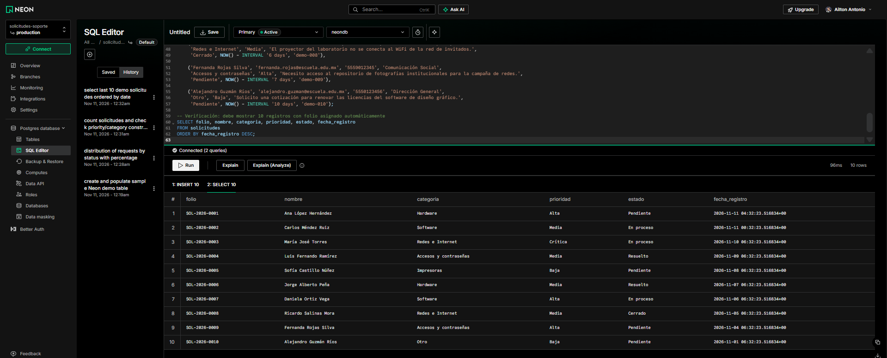
  <figcaption><strong>Figura 1.</strong> Tabla <code>solicitudes</code> en Neon con los folios generados automáticamente por el trigger de la base de datos.</figcaption>
</figure>
<figure>
  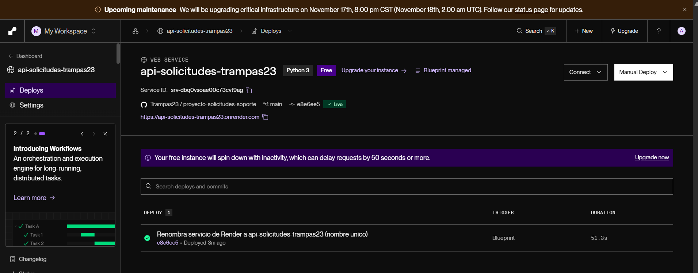
  <figcaption><strong>Figura 2.</strong> Servicio de la API REST desplegado en Render, en estado <strong>Live</strong>.</figcaption>
</figure>
<figure>
  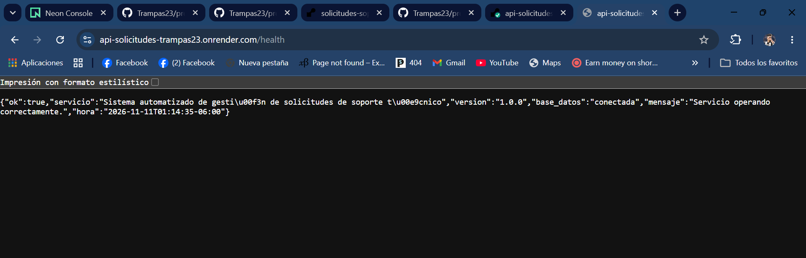
  <figcaption><strong>Figura 3.</strong> Respuesta de <code>GET /health</code> con <code>"base_datos": "conectada"</code>.</figcaption>
</figure>
<figure>
  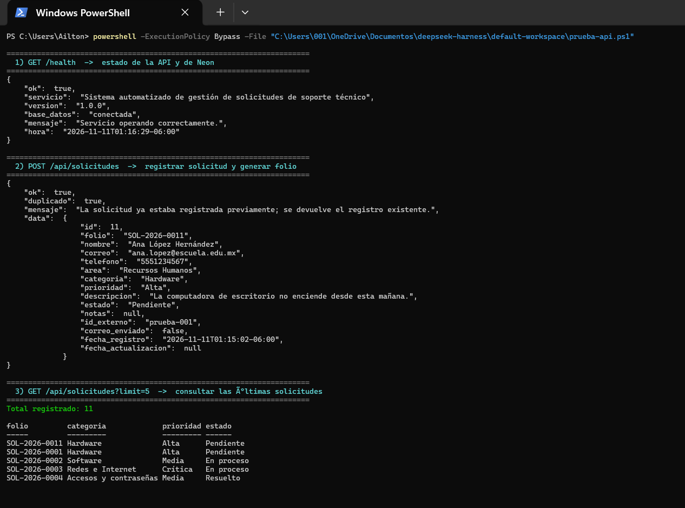
  <figcaption><strong>Figura 4.</strong> Pruebas de la API: registro de una solicitud con folio, consulta de solicitudes y estadísticas.</figcaption>
</figure>
<figure>
  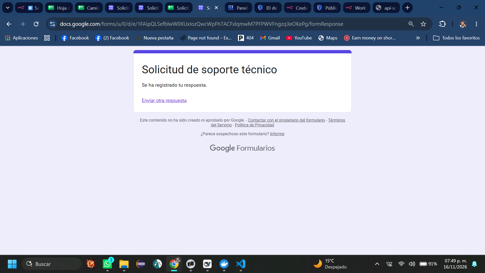
  <figcaption><strong>Figura 5.</strong> Confirmación del envío de una solicitud desde el Google Forms.</figcaption>
</figure>
<figure>
  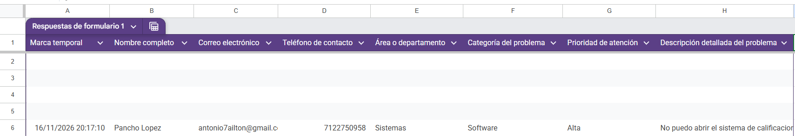
  <figcaption><strong>Figura 6.</strong> Hoja <code>Respuestas de formulario 1</code> vinculada al formulario, con los encabezados A–M.</figcaption>
</figure>
<figure>
  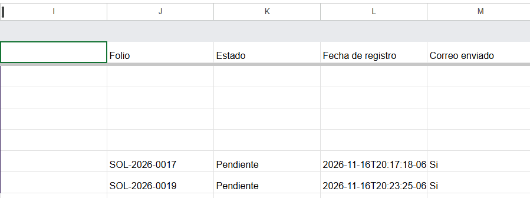
  <figcaption><strong>Figura 7.</strong> Columnas J–M completadas por n8n: folio, estado, fecha de registro y correo enviado.</figcaption>
</figure>
<figure>
  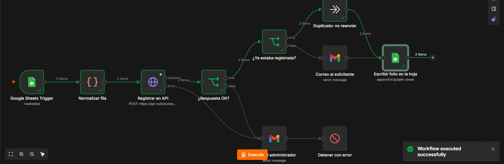
  <figcaption><strong>Figura 8.</strong> Workflow de n8n publicado y ejecutado correctamente: todos los nodos en verde.</figcaption>
</figure>
<figure>
  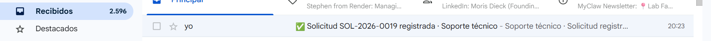
  <figcaption><strong>Figura 9.</strong> Correo de notificación enviado al solicitante con el folio de seguimiento.</figcaption>
</figure>
<figure>
  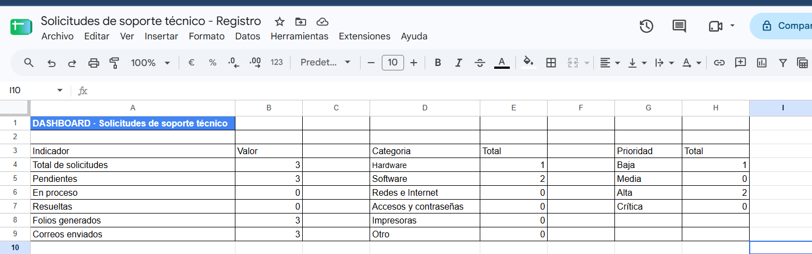
  <figcaption><strong>Figura 10.</strong> Pestaña <code>Dashboard</code> con los indicadores y las tablas de solicitudes por categoría y prioridad.</figcaption>
</figure>
<figure>
  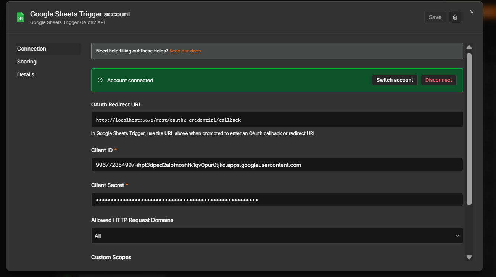
  <figcaption><strong>Figura 11.</strong> Credencial OAuth 2.0 de Google Sheets conectada en n8n.</figcaption>
</figure>
<figure>
  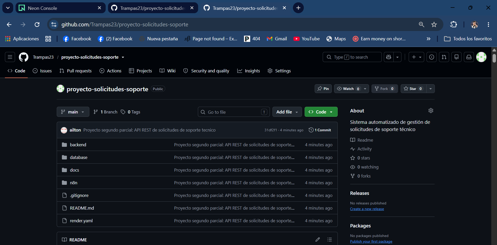
  <figcaption><strong>Figura 12.</strong> Repositorio del proyecto en GitHub con el código fuente y la documentación.</figcaption>
</figure>
<figure>
  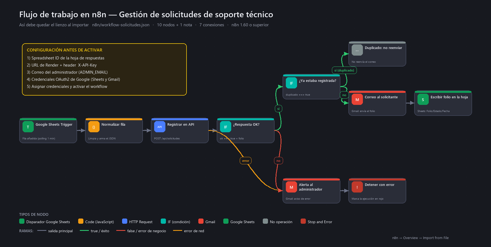
  <figcaption><strong>Figura 13.</strong> Diagrama del workflow de n8n: disparador de Google Sheets, normalización, llamada a la API, envío de correo y escritura del folio en la hoja.</figcaption>
</figure>

---

## 4. Conclusiones

El proyecto cumplió el objetivo de automatizar el ciclo completo de una solicitud de soporte técnico con un modelo cliente-servidor real:

1. **Se implementó una API REST propia y desplegada en la nube.** Flask + Gunicorn sobre Render, con PostgreSQL administrado en Neon, health check, manejo uniforme de errores y configuración reproducible mediante `render.yaml`. La API no solo almacena: valida, normaliza, autentica y traduce errores técnicos a mensajes en español.
2. **El folio se resolvió en el lugar correcto.** Generarlo con una secuencia y un trigger de PostgreSQL garantiza unicidad y orden incluso con inserciones concurrentes o reintentos; es un ejemplo práctico de por qué las reglas de integridad pertenecen también a la base de datos y no solo a la aplicación.
3. **La automatización eliminó el trabajo manual.** n8n detecta la respuesta del formulario, registra la solicitud, notifica al solicitante y actualiza la hoja sin intervención humana; la rama de error avisa al administrador cuando algo falla, y la idempotencia por `id_externo` evita duplicados en los reintentos.
4. **La separación por capas facilitó el desarrollo y las pruebas.** `app.py` (endpoints), `utilidades.py` (validación) y `database.py` (persistencia) permitieron probar la lógica sin base de datos: las 34 pruebas de humo se ejecutan en segundos y cubren los códigos HTTP, la autenticación y el formato de las respuestas.
5. **El dashboard en Google Sheets demostró que una herramienta cotidiana puede convertirse en un tablero de gestión** cuando los datos llegan ordenados y consistentes desde la API.
6. **Los servicios gratuitos tienen límites que el diseño debe asumir:** cold start de hasta un minuto en Render, suspensión del cómputo de Neon, prueba de 14 días de n8n y tokens OAuth de 7 días en modo prueba. Documentarlos y ajustar los timeouts del workflow fue parte del trabajo profesional, no un accidente.
7. **La principal deuda técnica es la seguridad de las lecturas:** los `GET` son públicos y la API key es única y compartida. El siguiente paso natural es agregar autenticación de usuarios, roles y auditoría, que quedan como trabajo futuro.

En conjunto, el sistema demuestra un flujo completo *formulario → automatización → API → base de datos → notificación → tablero*, con documentación reproducible y evidencia de pruebas, que es exactamente el tipo de integración que la materia busca: un cliente (Google/n8n) consumiendo un servicio propio (Flask) que persiste en una base de datos relacional (PostgreSQL).
